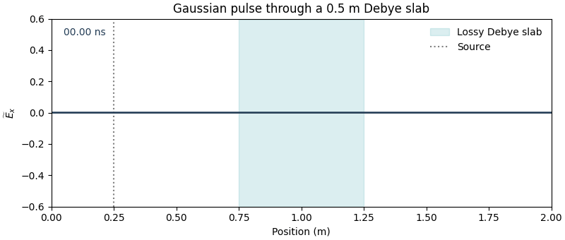

# HW9 — 1D FDTD for a Lossy Debye Slab
Computational Electrodynamics and Nanophotonics
This project extends the 1D Yee FDTD solver from HW8 to model conductive and dispersive media. The solver advances the electric flux density \(D_x\) and recovers the electric field \(E_x\) using auxiliary variables for conductivity and Debye polarization.

## Simulations

- **Lossy dielectric** driven by a 700 MHz sinusoidal source.
- **Lossless dielectric half-space** with a Fourier field profile at 500 MHz.
- **Debye half-space** with Fourier field profiles at 50, 200, and 500 MHz.
- **0.5 m Debye slab in vacuum**, with reflection, transmission, and absorption spectra from 1 to 2000 MHz.

For the finite slab, the FDTD spectra are compared with the analytical Fresnel solution, which includes multiple internal reflections. The weak Fabry–Pérot fringes appear in both solutions. The largest absolute difference across the three power coefficients is approximately \(5.8\times10^{-4}\).

## Run the code

```bash
python -m pip install numpy matplotlib pillow
python hw9_fdtd.py
```

To run the slab comparison and generate its animation:

```bash
python hw9_fdtd.py slab --gif
```

The script writes the results to `outputs/`, including the slab spectra as a PDF and CSV. On Windows, `py` can be used in place of `python`.

## Slab animation

The shaded region marks the Debye slab. The animation shows the incident Gaussian pulse splitting into reflected and transmitted components and attenuating as it travels through the slab.


